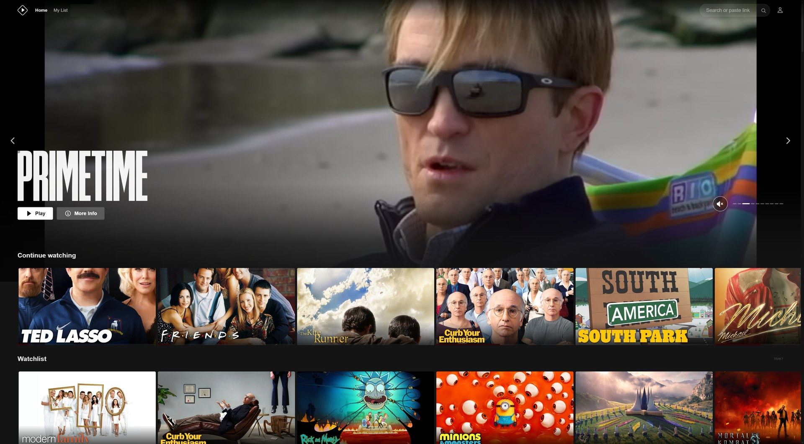

# Stremio Neo

**Stremio, with the stream picking done for you.** Press play and the best stream starts. Browse a cinematic home screen with trailers. Subtitles line themselves up. Your Trakt watchlist and ratings are built in.

Stremio Neo is a free, unofficial interface that runs inside the Stremio app you already have. Same account, same add-ons, same library.

**[⬇ Download for Windows](https://github.com/jeromenicholas07/stremio-neo/releases/latest/download/StremioNeo.exe)** · [Mac](#mac) · [iPhone and iPad](#iphone-and-ipad) · [Try it in your browser](https://jeromenicholas07.github.io/stremio-neo/#/)



> Stremio Neo is a community project. It is not made by, affiliated with, or endorsed by Stremio.

## Get started

You need a Stremio account with your add-ons already set up. If you use Stremio today, you have that.

1. **Install Stremio** from [stremio.com/downloads](https://www.stremio.com/downloads) if you don't have it, and sign in once.
2. **Download [`StremioNeo.exe`](https://github.com/jeromenicholas07/stremio-neo/releases/latest/download/StremioNeo.exe)** and save it somewhere permanent, such as your Documents folder.
3. **Double-click it.** Stremio opens with the Neo interface.

Windows shows a blue "Windows protected your PC" box the first time, because the file isn't code-signed. Click **More info**, then **Run anyway**.

After the first run there is a **Stremio Neo** entry in your Start Menu. Neo updates itself each time it starts, so there is nothing to download again.

New to Stremio? The [full setup guide](#full-setup-guide) walks through the account and add-ons too.

## What you get

### Auto-Pick: press play, skip the stream list

Stremio normally shows a long list of streams and leaves you to guess. Neo picks for you and starts playing.

- **Your order, your rules.** Drag sources (Real-Debrid cached, other debrid services, P2P) and qualities (4K HDR, 4K, 1080p, 720p) into the order you prefer, and switch off any you never want.
- **Recovers on its own.** If a stream is dead, Neo goes back and plays the next best one.
- **Skips blocked Real-Debrid files.** Real-Debrid sometimes serves a short error clip in place of a removed file. Neo recognises those and moves on before you see them.
- **Next episode just plays.** When an episode ends, Neo picks a fresh stream for the next one.
- **Picks up where you were.** Resuming a show reuses the stream you were already watching.
- **Per-show settings.** Keep the global order, or set a different one for a single show.

Turn it on or off in **Settings → Modern UI → Playback → Auto-Pick Stream**. The stream list is still there whenever you want to choose by hand.

### A home screen built for browsing

- A hero banner that plays trailers for what's new and popular.
- Hover a poster to preview its trailer, then mark it watched, rate it, add it to your watchlist, or hide it with **Not Interested**.
- **My List** gathers Continue Watching, your library, watchlist and recommendations in one place.
- The home screen appears instantly when you reopen the app, then refreshes in the background.

### Trakt built in

Connect your own [Trakt](https://trakt.tv) account under **Settings → Modern UI → Connect to Trakt**.

- Watchlist, ratings and watch history sync both ways, and what you watch is scrobbled as you go.
- Home rows from Trakt: recommendations for you, Trending, Popular, Anticipated, Box Office.
- Curated lists: IMDb Top 250, Letterboxd Top 250, Oscar Best Picture winners, A24, Studio Ghibli, the MCU.
- You stay signed in to Trakt even after reinstalling Stremio.

### Subtitles that sync themselves

Pick a subtitle from an add-on and Neo listens to a few seconds of the audio, works out how far off the subtitle is, and corrects the delay. It runs on your own computer using the Whisper speech model; no audio leaves your machine. The model (about 75 MB) downloads once, the first time you use it.


### Small things that add up

- **Audio comes back after a Bluetooth drop.** If your headphones or speaker disconnect and reconnect mid-film, sound returns without restarting the stream.
- **One file, always current.** The launcher updates itself and the interface on every start, and installs Stremio's own updates when they are ready.
- **Trailers in your language**, from a choice of 12.

### Optional extras

Off by default, under **Settings → Modern UI**: torrent search results in Search, and a PIN-locked private section. Both are Windows only and download extra components when switched on.

## Platforms

| | What works | How to get it |
|---|---|---|
| **Windows** | Everything | [`StremioNeo.exe`](https://github.com/jeromenicholas07/stremio-neo/releases/latest/download/StremioNeo.exe) |
| **iPhone / iPad** | The interface, Auto-Pick, Trakt. Streams must come from a debrid service; P2P can't play on iOS. Some formats hand off to Infuse or VLC. | Add to Home Screen from Safari, see [below](#iphone-and-ipad) |
| **Mac** | The interface, Auto-Pick and Trakt. No automatic subtitle speed-up, blocked-file check, or optional extras yet. | [`StremioNeo-mac.zip`](https://github.com/jeromenicholas07/stremio-neo/releases/latest/download/StremioNeo-mac.zip), see [below](#mac) |

## Full setup guide

About ten minutes, most of it waiting for downloads. Steps 1 to 3 must be done on a computer, even if you mainly want Neo on your iPhone.

### 1. Install Stremio

Download Stremio from [stremio.com/downloads](https://www.stremio.com/downloads) and run the installer. This is the official app; Neo runs inside it.

### 2. Create a Stremio account

Open Stremio and choose **Sign up**, or **Log in** if you have an account. Your account stores your library, add-ons and settings, and Neo reads them from there.

### 3. Add your add-ons

Stremio on its own has nothing to play. **Add-ons** provide the content, and you choose which ones to trust.

1. Click **Add-ons** in Stremio.
2. Install the ones you want.
3. If an add-on has settings, such as a key for a service you pay for, click **Configure** and fill them in.

Add-ons are stored on your account, so you only do this once. Sign in on another device and they are already there. Adding add-ons from an iPhone is unreliable; use a computer.

### 4. Run Stremio Neo

Follow [Get started](#get-started) above. Keep the launcher running while you watch; closing it closes Stremio.

### 5. Connect Trakt (optional)

1. Create a free account at [trakt.tv](https://trakt.tv).
2. In Neo, open **Settings** (the person icon, top right) and choose **Modern UI**.
3. Under **Trakt Integration**, click **Connect to Trakt**.
4. A short code appears and trakt.tv/activate opens. Paste the code there and approve.
5. Click **Sync Now** to pull in your watchlist and ratings.

### 6. Set your preferences (optional)

Still in **Settings → Modern UI**:

- **Auto-Pick Stream**: drag Sources and Quality into your preferred order.
- **Trailer Language**: the language trailers play in.
- **TMDB API Key** and the Trakt **Advanced** fields are already filled in. Leave them unless you have your own keys.

## Mac

1. Install Stremio from [stremio.com/downloads](https://www.stremio.com/downloads) into Applications and sign in once.
2. Download [`StremioNeo-mac.zip`](https://github.com/jeromenicholas07/stremio-neo/releases/latest/download/StremioNeo-mac.zip) and unzip it.
3. Right-click **Stremio Neo** and choose **Open**, then **Open** again. macOS asks because the app isn't notarised; you only do this once.

The Mac build opens Stremio with the Neo interface. It doesn't yet include the helper services the Windows launcher runs, so the features listed in the [platform table](#platforms) are Windows only for now. The Mac build is new and has had little testing; please [open an issue](https://github.com/jeromenicholas07/stremio-neo/issues) if it doesn't start.

## iPhone and iPad

There is nothing to install from the App Store. Neo runs as a web app on your Home Screen.

**First, on a computer:** create your Stremio account and add your add-ons (steps 1 to 3 above).

1. Open **Safari** and go to [jeromenicholas07.github.io/stremio-neo](https://jeromenicholas07.github.io/stremio-neo/#/). It has to be Safari.
2. Tap **Share**, then **Add to Home Screen**, then **Add**.
3. Open **Stremio Neo** from your Home Screen and log in with your Stremio account.
4. Leave **Settings → Streaming** server URL empty. iPhones can't run the streaming server and don't need it.
5. Install [Infuse](https://apps.apple.com/app/infuse-7/id1136220934) or VLC. Safari can't play some formats (MKV, HEVC, AC3, 4K HDR); when that happens the player offers a button to open the stream in one of those apps.

Peer-to-peer streams don't work on iPhone. You need an add-on backed by a service that streams over HTTPS, such as Real-Debrid. Auto-Pick already prefers streams your iPhone can play.

The web app updates itself when opened. If it seems stuck on an old version, remove the Home Screen icon and add it again; nothing is lost.

More detail: [docs/IOS.md](docs/IOS.md).

## Privacy

- Neo talks to the same services Stremio does, plus Trakt and TMDB if you use those features.
- Page views are counted anonymously with [GoatCounter](https://www.goatcounter.com), which uses no cookies and stores no personal data.
- Trakt and TMDB app keys are included so things work out of the box. They are shared by everyone using Neo; you can enter your own in **Settings → Modern UI**. Connecting Trakt signs in to your own account, and nothing is shared with anyone else.
- Subtitle sync runs entirely on your device.

## If something goes wrong

**Stremio opens but the window is blank.**
Close everything, wait a few seconds, and run Stremio Neo again. The interface loads from the web on each start, so check your connection.

**The launcher closes immediately, or says a port is in use.**
An old copy is still running. Open Task Manager (Ctrl+Shift+Esc), end any `Stremio` or `StremioLauncher` tasks, and try again.

**Nothing plays.**
That is the add-on side. In Stremio's **Add-ons** section, check that what you installed is still working and configured.

**Auto-Pick chose a stream I didn't want.**
Reorder or switch off sources and qualities in **Settings → Modern UI → Auto-Pick Stream**, or turn Auto-Pick off for that one show from its streams page.

**I had the older "Stremio Custom UI" launcher.**
It updates itself to Stremio Neo the next time it starts. Your login and settings carry over.

**I want to start over.**
Delete the folder `%LOCALAPPDATA%\StremioLauncherFULL` (paste that into the Explorer address bar). The next launch rebuilds it.

**I want to remove it.**
Delete that folder and `StremioNeo.exe`, and remove the **Stremio Neo** Start Menu entry. Stremio itself is untouched and opens normally from its own shortcut.

**On iPhone: no "Add to Home Screen".**
You're not in Safari. Chrome and Firefox on iOS don't offer it.

**On iPhone: a stream won't play, or has sound but no picture.**
Safari can't decode that file. Tap the **Infuse** or **VLC** button in the player.

## For developers

Requires Node.js 18+ and [pnpm](https://pnpm.io/installation) 10+.

```bash
pnpm install
pnpm start
```

Building and deploying, including the launcher, is covered in [BUILD.md](BUILD.md).

## Credits and licence

Stremio Neo is based on [Stremio Web](https://github.com/Stremio/stremio-web), copyright 2017-2023 Smart Code, and is available under GPLv2. See [LICENSE](LICENSE.md).
