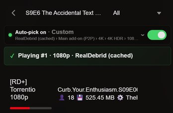
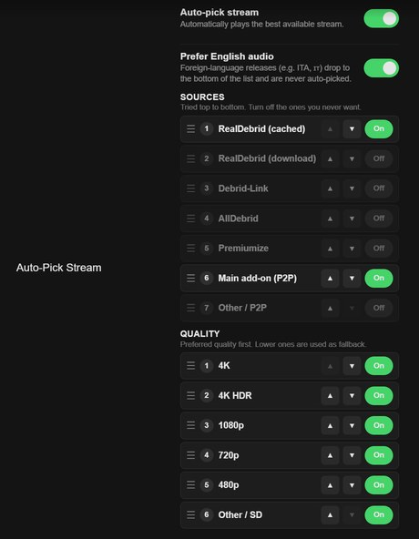
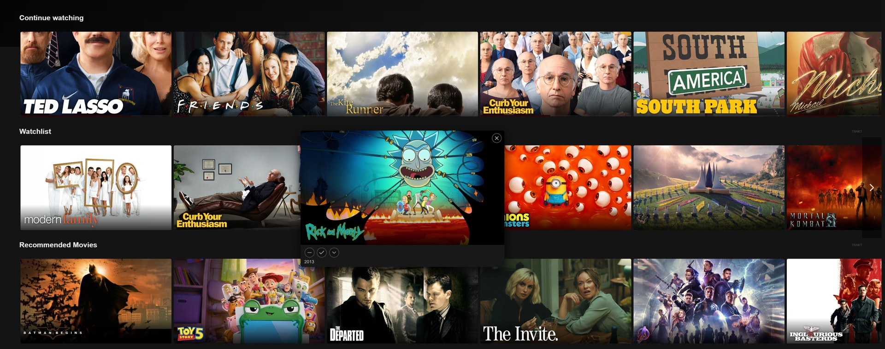

# Stremio Neo

**Stremio, with the stream picking done for you.** A free, unofficial interface that runs inside the Stremio app you already have. Same account, same add-ons.

**[⬇ Download for Windows](https://github.com/jeromenicholas07/stremio-neo/releases/latest/download/StremioNeo.exe)** · [Mac](https://github.com/jeromenicholas07/stremio-neo/releases/latest/download/StremioNeo-mac.zip) · [iPhone / iPad](docs/GUIDE.md#iphone-and-ipad) · [Try in browser](https://jeromenicholas07.github.io/stremio-neo/#/)

## What it does

| | |
|---|---|
| ▶️ **Auto-Pick** | Press play and the best stream starts. You set the source and quality order; dead or blocked streams are skipped, and the next episode plays by itself. |
| 🎬 **Cinematic home** | Trailer banner, hover previews, one-click watched / rate / watchlist, and a My List page. |
| 📋 **Trakt built in** | Watchlist, ratings and history sync, plus recommended and curated rows. |
| 💬 **Self-syncing subtitles** | Subtitles are lined up to the audio automatically, on your own device. |
| 🔊 **Fewer interruptions** | Audio returns after a Bluetooth reconnect. The home screen opens instantly. Updates itself. |

  
  &nbsp;
  
  &nbsp;
  

## Install (Windows)

1. Install [Stremio](https://www.stremio.com/downloads) and sign in.
2. Download [`StremioNeo.exe`](https://github.com/jeromenicholas07/stremio-neo/releases/latest/download/StremioNeo.exe) and keep it somewhere permanent.
3. Double-click it. On the blue Windows warning, click **More info → Run anyway**.

That's it. Neo updates itself, and adds a **Stremio Neo** entry to your Start Menu.

## Platforms

| | Works | Get it |
|---|---|---|
| **Windows** | Everything | [`StremioNeo.exe`](https://github.com/jeromenicholas07/stremio-neo/releases/latest/download/StremioNeo.exe) |
| **iPhone / iPad** | Interface, Auto-Pick, Trakt (debrid streams only) | [Add to Home Screen](docs/GUIDE.md#iphone-and-ipad) |
| **Mac** | Interface, Auto-Pick, Trakt (new, lightly tested) | [`StremioNeo-mac.zip`](https://github.com/jeromenicholas07/stremio-neo/releases/latest/download/StremioNeo-mac.zip) |

## More

- [Full guide](docs/GUIDE.md): step-by-step setup, Trakt, iPhone, Mac, troubleshooting, privacy
- [Build from source](BUILD.md)
- Settings live under **Settings → Modern UI**

Not affiliated with or endorsed by Stremio. Based on [Stremio Web](https://github.com/Stremio/stremio-web), GPLv2. See [LICENSE](LICENSE.md).
